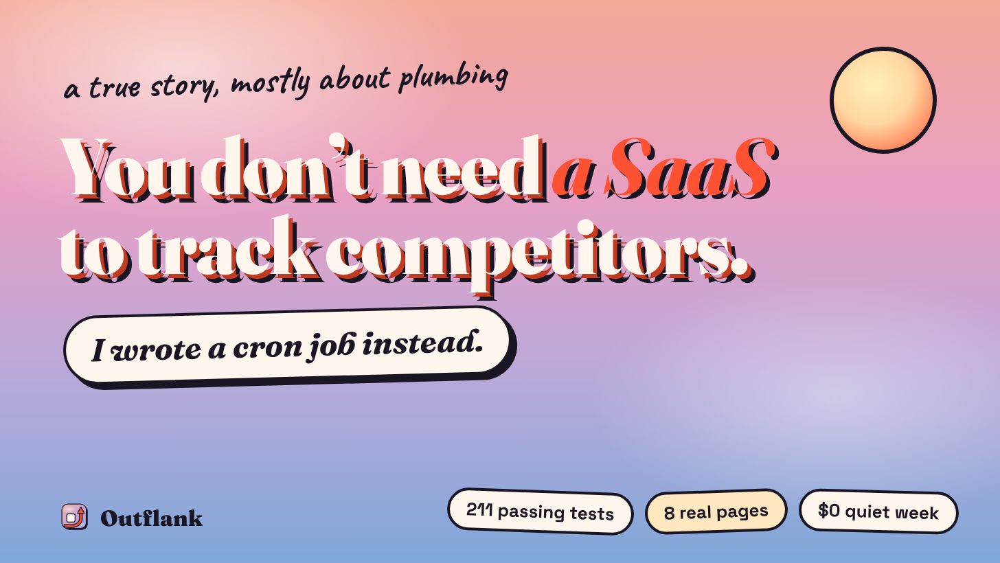
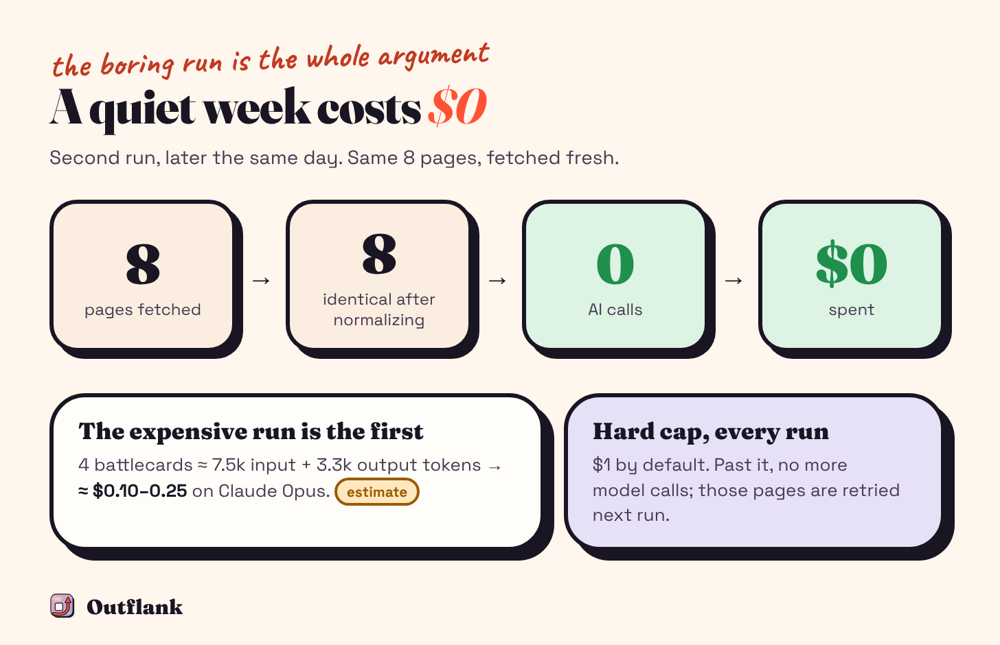

# You don’t need a SaaS to track competitors. I wrote a cron job instead.

### It costs nothing on a quiet week. Getting there took 211 passing tests, three real websites that broke my assumptions, and one battlecard that told me not to pitch Hindi.

*By Rudra Trivedi, freelance GTM engineer*

If you’ve worked in sales ops, you know the moment. A rep is deep in a deal, and the buyer says a competitor just changed its pricing. Nobody on your side knew. The battlecard in the shared drive still shows last quarter’s plans.

The usual answer is another subscription: a competitive-intelligence tool with a dashboard, seats and a renewal date. I wanted to test a cheaper idea.

**My bet: competitor tracking can be a cron job, not a subscription.** Code does the watching. AI reads only what changed. Everything lives in a private Git repo you already own.

So I built one. It’s called **Outflank**, and it’s open source.

## The bet

Strip competitor tracking down and it’s four jobs: watch the pages that matter, notice when something real changes, explain what it means for you, and keep the battlecard current. None of that needs a server running all day. It needs a schedule.

Outflank is a command-line tool plus a GitHub Actions template. Once a week, a workflow in your own private repo fetches your competitors’ pricing, product and changelog pages. It turns them into clean text, strips the noise and compares each page with last week’s copy. Only pages that really changed go to an AI model. Snapshots, digests and battlecards are plain files in the repo, so Git history is your change log. You bring one secret: your own Anthropic API key.

Most of the design follows one rule: **make the AI earn every call.** Code checks `robots.txt`, fetches politely and removes things that change on every visit, like “3 hours ago”, copyright years and tracking parameters. Then it diffs the result. Tiny diffs are logged without calling a model. Keyword triggers you choose, like “free plan” or “enterprise”, are checked first, so they’re never skipped, even on a one-word change. A fast, cheap model sorts what’s left into noise, minor or material. Only material changes reach the stronger model. Every run has a hard dollar cap.

## Green across the board

I built it the boring way: small pull requests and 211 tests, all passing. Every website and every AI call in those tests was mocked.

That last part is exactly the problem. A mocked website never redirects you. A mocked API never rejects your request.

## Then I pointed it at real competitors

For the example, I imagined an AI sales roleplay and coaching tool for enterprise sales teams in India, mainly in BFSI and pharma. I picked four vendors in that space to watch: **Mindtickle, Awarathon, Second Nature and Hyperbound**. That’s eight public pages in total. They’re here as examples of what the tool does with real pages, not as a review of those companies.

Real websites broke three of my assumptions before the first digest was written.

**One competitor showed me a different company.** Convin was on my first list. From the server I ran it on, convin.ai redirected to a US site for home-service businesses, a different product entirely. If your tracker runs in one country and your buyers are in another, you might be watching the wrong website. I replaced it with Second Nature.

**One pricing page was an experiment.** Hyperbound’s `/pricing` quietly redirected to `/pricing-b`, which looks like an A/B test. If the variant flips next week, a naive tracker reports a “pricing change” nobody made. The fix is to watch a stable part of the page, or ignore the parts that flip.

**One page was almost empty.** Second Nature’s financial-services page came back as 208 characters. The page has far more on it, but the default extraction kept only a fragment. One `include` selector pointing at the main content brought back 4.7k characters.

None of these would ever show up in a test suite.

## The battlecard that told me not to pitch Hindi

On the first run, Outflank saves every page as a baseline and the AI writes a battlecard per competitor from the page text. The prompt has two strict rules: state only what the pages support, and label anything inferred as inference.

For a tool selling to Indian enterprise teams, Hindi roleplays look like the obvious edge. The Hyperbound battlecard disagreed. Their banking page lists 25+ languages, including Hindi, Gujarati, Marathi and Tamil. So the card said it plainly: don’t lead with “we support Hindi”; lead with Indian BFSI and pharma scenarios and compliance instead.

That’s the part a page-change alert can’t give you. Knowing a page changed is a notification. Knowing what it does to your pitch is intelligence.

## The boring run is the whole argument

Later that day I ran it again. All eight pages were fetched fresh, and after normalization every one was identical to its snapshot. Eight unchanged, zero AI calls, $0.

That boring result is the argument. A subscription costs the same every month, whether your competitors move or not. A cron job costs nothing when nothing happens. The expensive run is the first one, which writes every battlecard. For the four in this example, I estimated about 7.5k input and 3.3k output tokens, or roughly $0.10 to $0.25 on Claude Opus. And every run has a hard cap, $1 by default.

My expectation, and it could turn out to be wrong, is that most weeks will look like that second run. Most pages don’t change most weeks.

## What broke wasn’t the AI

Here’s what surprised me most. Across the whole build, the things that broke had almost nothing to do with the model.

- **The request format.** The JSON schema I sent the model used a keyword (`minLength`) that the API’s docs list as unsupported. Every live AI call would likely have failed. The tests couldn’t see it, because they mocked the API.
- **The workflow deleted its own engine.** For pages that need a headless browser, a second `npm install --no-save` quietly removed the package the first install added.
- **Docker read a comment as the API key.** `KEY=   # note` works with dotenv, but Docker’s `--env-file` reads the value as `# note`.
- **Alerts could ping people.** A competitor page containing `<!channel>` or `@someone` could have pinged a whole Slack channel or a random GitHub user. All output is now escaped.
- **CI broke the tests.** The test suite inherited the CI runner’s environment and took a different code path there than on my machine.
- **Publishing had its own gate.** npm required two-factor authentication, then staged the first release behind a placeholder version.

In my runs, the model was the least of my problems. A cron job is mostly plumbing, and plumbing is something you can own, test and fix yourself.

One honest caveat, stated once. Outflank hasn’t caught a real competitor change yet, because none of the pages changed between my runs. The weekly schedule hasn’t had its first live run on GitHub either. The change example in the repo uses made-up companies to show the format.

## Copy this: the live-run checklist

If you’re building or buying any AI tool for GTM, this is my rule of thumb before trusting it:

1. **Run it on three real sites** before you trust it.
2. **Read what it extracted, not what it concluded.** A 208-character page will still produce a confident summary.
3. **Run it twice.** If the second run isn’t quiet, your noise filtering is wrong.
4. **Check the final URL.** Geo redirects and A/B tests are real.
5. **Filter before you call a model.** Keywords and size thresholds are free.
6. **Cap the cost of every run.**
7. **Escape everything you send to Slack or GitHub.**

And a decision rule, also a rule of thumb: **if the pages you care about change weekly or slower, a cron job beats a subscription.** If you need minute-level alerts across hundreds of pages, or nobody on your team can own a small repo, buy the tool.

## Try it

Outflank is free and open source under the MIT license. Create a private repo from the template, add your Anthropic API key as a secret, list your competitors in one YAML file, and it’s set to run every Monday.

- **Template:** [github.com/rudrat04/outflank-template](https://github.com/rudrat04/outflank-template)
- **Code and docs:** [github.com/rudrat04/outflank](https://github.com/rudrat04/outflank)

If you want something like this built for your team, for competitor intel or any other GTM workflow, message me.

**What would you watch first: competitors’ pricing pages, changelogs or careers pages?**
